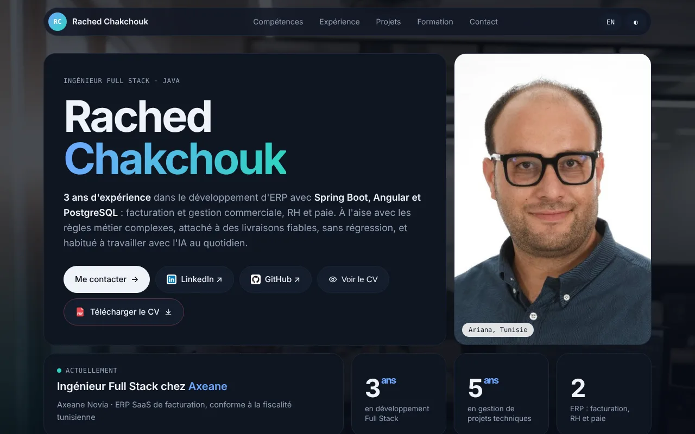
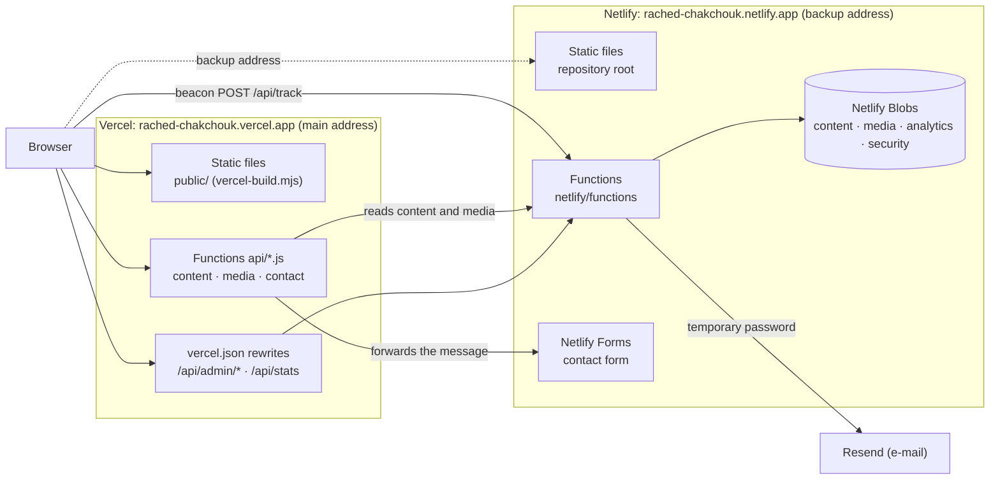

# Rached Chakchouk — Portfolio

[Français](README.md) · **English**

Bilingual (French / English) personal website of Rached Chakchouk, Full Stack Software Engineer (Java / Spring Boot / Angular): a framework-free static home page, public sub-pages, a private dashboard and a small serverless back-end (Netlify Functions and Netlify Blobs).

- Main address: https://rached-chakchouk.vercel.app (Vercel)
- Backup address: https://rached-chakchouk.netlify.app (Netlify, not indexed), which also hosts the back-end



## Overview

**Home page** (`index.html`, logic in `assets/site.js`):

- French or English (button, `?lang=en`, `#en` / `#fr`), light or dark theme (system preference by default); both choices are saved in `localStorage`;
- skills, experience, internships, projects, education, languages and certifications, rendered from the site content (see "Site content and storage");
- projects: category filters, sorting (featured, most recent, name), grid or list view, detail modal and screenshot album;
- online resume viewer (FR / EN) and PDF download;
- contact form with in-browser validation and an anti-spam honeypot field;
- accessibility panel (`assets/a11y.js`: text-to-speech narrator, magnifier and text size, colour-blind and high-contrast modes), carbon footprint counter for the visit (`assets/carbon.js`, computed locally, no data sent), reduced animations when `prefers-reduced-motion` is set;
- cookie-free visit analytics (see "Visit analytics").

**Public sub-pages**:

| Path | Content |
|---|---|
| `/entretien/` | technical interview questions (Java, Spring Boot, JPA, SQL, Angular, RxJS, REST, Git, Docker) explained with animated diagrams, FR / EN, and their PDF version |
| `/entretien/qcm/` | randomly drawn revision quiz (questions in `mcq.json`), FR / EN |
| `/jobradar/` | presentation of the JobRadar project (AI-assisted job watch), FR / EN |
| `/offshore-it-tunisie/` | directory of offshore and nearshore IT companies in Tunisia (`data.json`, logos) |
| `/conditions/` | legal notice and terms of use, FR / EN |
| `/merci/` | confirmation page after a form submission without JavaScript (not indexed) |

**Private dashboard** (`/dashboard/`, "Portfolio Analytics", logic in `assets/dashboard.js`):

- password login, password change, "Mot de passe oublié ?" (forgotten password: a temporary password is sent by e-mail);
- **Statistiques**: visits and visitors per day, countries, cities, sources, devices, browsers, languages, visitor actions, viewed projects and latest visits, over 7, 30 or 90 days;
- **Contenu du site**: French and English editing of the profile, experience, internships, projects, skills, education, languages and certifications (add, edit, reorder, delete), then "Publier" (publish); the original content can be restored;
- **CV, photo et images**: replace or reset the FR / EN resumes (PDF, 4 MB max) and the profile photo, upload images for projects or logos (JPG, PNG or WebP, 3 MB max);
- a clearly labelled demo mode with fictitious data.

## Tech stack

| Layer | Technology | Version |
|---|---|---|
| Pages | HTML, CSS and JavaScript, no framework, no build step | — |
| Fonts | Geist, Geist Mono (Google Fonts) | — |
| Serverless functions | Netlify Functions (ES modules, esbuild bundler) and Vercel functions (`api/*.js`) | — |
| Storage | Netlify Blobs (`@netlify/blobs`) | ^10.7.13 |
| Form | Netlify Forms | — |
| E-mail | Resend API | — |
| Analytics | in-house tracking (Netlify functions) and Vercel Web Analytics | — |

No Node.js version is pinned in the repository (no `engines` field, no `.nvmrc`); local checks were run with Node.js 22. Technology icons: Devicon and Simple Icons (see `LICENSE`).

## Architecture

The same repository feeds two deployments:

- **Vercel** (main address): `scripts/vercel-build.mjs` copies an explicit list of public files into `public/` (pages, content, resumes, images, `assets/` scripts, dashboard), adds `assets/va.js` (Vercel Web Analytics) to the public HTML pages but not to the dashboard, and generates `robots.txt` (indexing allowed except `/dashboard/`, `/api/` and `/merci/`) and `sitemap.xml` (public pages, FR / EN variants). The `netlify/` folder is not published. The `api/*.js` functions have no storage of their own: they read the Netlify back-end (`MAIN` in `api/_main.js`) with a timeout and fall back to the static files; `/api/admin/*` and `/api/stats` are rewritten to Netlify (`vercel.json`).
- **Netlify** (backup address and back-end): `netlify.toml` publishes the repository root as is (`publish = "."`, no build command) and deploys the functions in `netlify/functions`. Data (Netlify Blobs), the contact form (Netlify Forms) and e-mail sending live on this side. `robots.txt` and the `X-Robots-Tag: noindex` header (`_headers`) keep this address out of search engines.



Home page behaviour by address (`assets/site.js`):

| Address | Content | Photo and resumes | Contact form | Visit tracking |
|---|---|---|---|---|
| `rached-chakchouk.vercel.app` | `/api/content` (Vercel relay) | `/media/*` (Vercel relay) | `POST /api/contact` (relayed to Netlify Forms) | beacon to `https://rached-chakchouk.netlify.app/api/track`, plus Vercel Web Analytics |
| other `*.vercel.app` (previews) | same | same | same | none |
| `rached-chakchouk.netlify.app` | `/api/content` | `/media/*` | `POST /` (Netlify Forms) | `/api/track` |
| any other address (including `localhost`) | embedded content | repository files | disabled: a message suggests copying the e-mail address | none |

The embedded content stays on screen when nothing has been published or when the back-end does not answer.

## Repository layout

```text
.
├── index.html               # home page: markup, styles, default content (#defaultContent)
├── content.json             # default content (same JSON as #defaultContent)
├── assets/
│   ├── site.js              # home page: content, language, theme, projects, resume, contact, tracking
│   ├── dashboard.js         # dashboard
│   ├── a11y.js              # accessibility panel (all pages)
│   ├── carbon.js            # carbon footprint counter
│   ├── float.js             # draggable, closable floating buttons
│   ├── totop.js             # "back to top" button
│   └── va.js                # Vercel Web Analytics (main address only)
├── dashboard/index.html     # private dashboard page
├── entretien/, jobradar/, offshore-it-tunisie/, conditions/, merci/   # public sub-pages
├── netlify/
│   ├── functions/           # one Netlify function per route (see "API")
│   └── lib/                 # analytics.mjs (tracking, media, tokens, content), auth.mjs (password, e-mail)
├── api/                     # Vercel functions: _main.js, content.js, media.js, contact.js
├── scripts/vercel-build.mjs # build of the Vercel address
├── vercel.json              # Vercel build, redirects, rewrites and headers
├── netlify.toml, _headers, robots.txt   # configuration, headers and robots of the Netlify address
├── projects/, logos/, bg/   # project screenshots, logos, background images
├── cv/                      # WebP previews of the resume pages (not referenced by the current code)
├── Rached_Chakchouk_CV_FR.pdf, Rached_Chakchouk_CV_EN.pdf, photo.jpg, og-image.jpg
├── .github/dependabot.yml   # weekly npm updates (Dependabot)
├── .well-known/security.txt, SECURITY.md, LICENSE
└── package.json             # @netlify/blobs dependency (no npm scripts)
```

## Prerequisites

- Static site only: any static file server (there is no build step).
- Functions and dashboard locally: Node.js and npm, plus the Netlify CLI (`netlify-cli`).

## Running locally

The commands are the same on Windows (PowerShell) and on Linux / macOS, except for setting environment variables.

### Static site

```bash
git clone https://github.com/rachedchakchouk/rached-chakchouk-portfolio.git
cd rached-chakchouk-portfolio
npx serve@14.2.6 -l 8080
```

Open http://localhost:8080. On `localhost` the page calls no API: it shows the embedded content and the photo and resumes from the repository; visit tracking and form sending are disabled. The dashboard (http://localhost:8080/dashboard/) then only offers the demo mode ("Voir une démo").

### With the Netlify functions (dashboard, API)

The repository has no `package-lock.json`: install the dependency with `npm install`, then the Netlify CLI.

```bash
npm install
npm install -g netlify-cli
```

PowerShell:

```powershell
$env:DASHBOARD_PASSWORD = "<local password>"
netlify dev --offline
```

Linux / macOS:

```bash
DASHBOARD_PASSWORD='<local password>' netlify dev --offline
```

The site and the functions are served on http://localhost:8888 (dashboard: http://localhost:8888/dashboard/). With `--offline`, no Netlify account is used: Netlify Blobs are emulated in the `.netlify/` folder, which the CLI keeps out of Git by creating a `.gitignore`. Set the variables in the shell session as shown above rather than in a `.env` file, which nothing excludes from Git in this repository.

On `localhost` the home page still calls neither `/api/content` nor `/media/*`: content published from the local dashboard is served by http://localhost:8888/api/content but not displayed by the page. "Mot de passe oublié" also needs `RESEND_API_KEY` (otherwise it answers 503 `mail_not_configured`).

### Vercel build

```bash
node scripts/vercel-build.mjs
```

The script generates `public/`, which nothing excludes from Git: do not commit it. The `api/*.js` functions always call the production back-end (`MAIN` in `api/_main.js`): running them locally, for instance with the Vercel CLI, would read the real data, and `/api/contact` would send a real message.

## Configuration

Environment variables of the Netlify functions (Netlify → Project configuration → Environment variables), read with `Netlify.env.get`. No value is stored in the repository.

| Variable | Purpose | Required |
|---|---|---|
| `DASHBOARD_PASSWORD` | initial dashboard password and signing secret of the session tokens; still needed after the password has been changed. Without it, the admin routes and `/api/stats` answer 503 `not_configured` | yes |
| `ANALYTICS_SALT` | salt of the visitor hash (unique visitors, rate limits); without it, a default value written in the code is used | recommended |
| `RESEND_API_KEY` | Resend API key for the forgotten-password e-mail; without it, `/api/admin/forgot` answers 503 `mail_not_configured` | for the forgotten password |
| `ADMIN_EMAIL` | recipient of that e-mail (default in `netlify/lib/auth.mjs`) | no |
| `MAIL_FROM` | sender of that e-mail (default in `netlify/lib/auth.mjs`) | no |

The Vercel deployment reads no environment variable. Both site addresses are written in the code, notably `MAIN` (`api/_main.js`), `MAIN_HOST` and `BACKUP_HOST` (`assets/site.js`), `MAIN_HOST` (`netlify/functions/track.mjs`), `TRUSTED_HOSTS` (`netlify/lib/auth.mjs`), `assets/va.js`, `scripts/vercel-build.mjs`, and the rewrites and CSP in `vercel.json`.

## Site content and storage

- **Default content**: `index.html` embeds the content JSON in `<script type="application/json" id="defaultContent">`, which the page reads on load; `content.json` holds the same JSON and is the dashboard's original content. Both must stay identical. Format: `version: 1`, `profile`, `skills`, `experiences`, `internships`, `projects`, `education`, `languages`, `certifications`, with bilingual texts `{ "fr": …, "en": … }`.
- **Published content and uploaded files**: Netlify Blobs. There is no database and no migration.

| Store | Keys | Content |
|---|---|---|
| `content` | `site` | published content (sanitized JSON, update date as metadata) |
| `media` | `cv-fr.pdf`, `cv-en.pdf`, `photo`, `img-<name>` | uploaded files, with type, size, date and original name |
| `analytics` | `e/<YYYY-MM-DD>/<timestamp>-<random>` | one record per page view or action |
| `security` | `auth/state`, `login-fail/…`, `forgot/…`, `rl/…`, `cap/…` | password state (scrypt hash, generation, temporary password) and rate-limit counters |

## API

Netlify functions (`netlify/functions/*.mjs`, route declared with `export const config = { path }`). "Token" means the `Authorization: Bearer <token>` header obtained at login; a "normal session" excludes a session opened with the temporary password, which can only be used to choose a new password.

| Method | Route | Access | Purpose |
|---|---|---|---|
| GET | `/api/content` | public | published content; 404 when nothing is published |
| GET | `/media/:name` | public | uploaded file; otherwise a 302 redirect to the original file (`cv-fr.pdf`, `cv-en.pdf`, `photo`) or 404 (`img-*`) |
| POST | `/api/track` | public (same origin or main address) | records a page view or an action (`cv_download`, `cv_view`, `linkedin`, `github`, `project_open`, `contact_submit`, `email_copy`, `phone_copy`) |
| POST | `/api/admin/login` | password | returns `{ token, exp, mustChange }` |
| POST | `/api/admin/forgot` | public, rate-limited | sends a temporary password to the admin address |
| POST | `/api/admin/password` | token | changes the password (`current` required except in a temporary session, `next`) and returns a new token |
| GET, PUT, DELETE | `/api/admin/content` | token, normal session | reads, publishes (JSON up to 400 KB, sanitized then validated) or deletes the published content |
| GET, PUT, DELETE | `/api/admin/media?name=` | token, normal session | lists, uploads (raw body, type checked by file signature) or deletes a file |
| GET | `/api/stats?days=` | token, normal session | aggregated statistics over 1 to 90 days (30 by default) |

Vercel functions and rules (`api/*.js`, `vercel.json`):

| Method | Route | Purpose |
|---|---|---|
| GET | `/api/content` | relays Netlify's `/api/content` (4 s timeout); 204 when Netlify does not answer or returns an error |
| GET | `/media/:name` | rewritten to `/api/media?name=`: relays the file from Netlify (6 s timeout), otherwise redirects to the static file |
| POST | `/api/contact` | checks the message (same origin, 6,000 characters max, honeypot, name, e-mail, message of at least 10 characters) and forwards it to the Netlify `contact` form (8 s timeout) |
| all | `/api/admin/*`, `/api/stats` | rewritten to the same Netlify routes |

Temporary redirects to `/dashboard/`: `/dashboard`, `/admin`, `/admin/`, `/dashborad`, `/dashborad/`.

## Visit analytics

- **Sending** (`assets/site.js`): `navigator.sendBeacon` with `text/plain` (no CORS preflight from Vercel) on each page view and on the tracked actions, only on the two production addresses. Nothing is sent when *Do Not Track* is on or when `rc_ignore` is `1` in `localStorage`; that flag is set when the dashboard is displayed, or by visiting the site once with `?notrack`.
- **Receiving** (`netlify/functions/track.mjs`): bots filtered by user agent; at most 40 events per visitor per 10 minutes and 5,000 per day; country and city come from Netlify's geolocation. IP addresses are never stored: a truncated SHA-256 hash of (salt, day, IP, user agent) identifies the visitor for the day.
- **Retention**: each call to `/api/stats` deletes records older than 13 months.
- **Vercel Web Analytics** (`assets/va.js`): loaded only on `rached-chakchouk.vercel.app`, with the same exclusions (*Do Not Track*, `rc_ignore`).

## Tests

The repository has no automated tests and no npm scripts. `netlify/lib/analytics.mjs` gathers the dependency-free logic (aggregation, user-agent parsing, sources, file checks, tokens, content sanitizing), which can be tested in isolation.

## Build, CI and deployment

- No GitHub Actions workflow. Dependabot (`.github/dependabot.yml`) proposes npm updates (`@netlify/blobs`) every Monday at 06:00 (Africa/Tunis): at most 5 open PRs, commit prefix `deps`, label `dépendances`, groups `securite` (security fixes) and `mineures-et-correctifs` (minor and patch updates).
- **Vercel**: `vercel.json` (`framework: null`, `buildCommand: node scripts/vercel-build.mjs`, `outputDirectory: public`). The Vercel project is connected to the repository: commits on `main` are deployed to production and PR branches to previews ("Vercel" statuses on the commits).
- **Netlify**: `netlify.toml` (`publish = "."`, functions in `netlify/functions`, esbuild bundler), no build command; the `contact` form is declared to Netlify Forms by its `data-netlify="true"` attribute (honeypot field `_gotcha`). The Netlify site is connected to the repository (PRs get Deploy Previews); publishing production deploys is configured in the Netlify UI, outside the repository. Since the admin and statistics routes of the Vercel address go through Netlify, check after any change in `netlify/` that the matching Netlify production deploy is published.

## Security

- **Headers** (`_headers` for Netlify, `vercel.json` for Vercel): HSTS (1 year, `preload`), CSP (`script-src 'self'` with no inline script; inline styles and Google Fonts allowed; on Vercel, `connect-src` includes the Netlify address for the tracking beacon), `frame-ancestors 'self'` and `X-Frame-Options: SAMEORIGIN`, `X-Content-Type-Options: nosniff`, `Referrer-Policy: strict-origin-when-cross-origin`, a restrictive `Permissions-Policy`, COOP and CORP `same-origin`, `Origin-Agent-Cluster`. On both hosts `/dashboard/` gets `noindex, nofollow` and `Cache-Control: no-store`.
- **Login**: the password is only sent to `/api/admin/login`; it is compared in constant time with `DASHBOARD_PASSWORD`, or with a salted scrypt hash once changed from the dashboard. The session token (HMAC-SHA256, 2 h) is kept in `sessionStorage`. 5 failed attempts from the same visitor lock logins for 15 minutes.
- **Password**: at least 10 characters and 3 character types; every change signs out all other sessions. The temporary password is valid for 15 minutes, single-use, and sent to the fixed admin address (never taken from the request); 3 requests per visitor per hour, 6 per day.
- **Origin**: login, forgotten password and password change only accept the same origin or `rached-chakchouk.vercel.app`; `/api/track` accepts the same origin or the main address.
- **Content and files**: content sanitized on the server (keys, lengths, depth, unsafe URLs removed) and always escaped when rendered; files limited in size, real type checked by signature, served with `nosniff` (plus a `sandbox` CSP for images).
- Reporting a vulnerability: [SECURITY.md](SECURITY.md) and `/.well-known/security.txt`.

## License

© 2026 Rached Chakchouk — all rights reserved. The code is published for viewing only; photos, resumes and personal content may not be reused without permission. See [LICENSE](LICENSE), which also lists the licenses of third-party assets (Devicon, Simple Icons, Geist fonts).

## Author

**Rached Chakchouk** — Full Stack Software Engineer (Java / Spring Boot / Angular)

- LinkedIn: [linkedin.com/in/rached-chakchouk](https://linkedin.com/in/rached-chakchouk)
- GitHub: [github.com/rachedchakchouk](https://github.com/rachedchakchouk)
