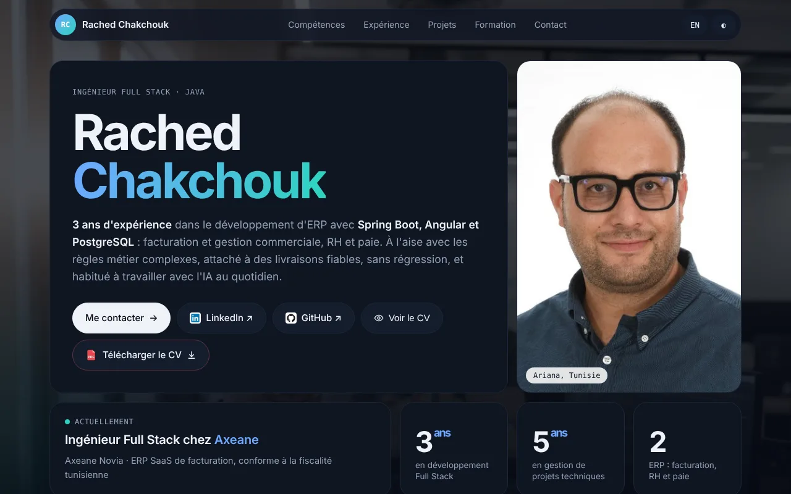

# Rached Chakchouk — Portfolio

**Full Stack Software Engineer · Java / Spring Boot / Angular**

🔗 **Live:** https://rached-chakchouk.vercel.app (backup: https://rached-chakchouk.netlify.app)



## About

Personal portfolio presenting my experience building business applications (invoicing & stock management, HR management)
(invoicing, Tunisian taxation, HR & payroll) with **Java, Spring Boot, Angular and PostgreSQL**.

## Features

- Bilingual **French / English** switch
- **Light / dark** theme (follows the system preference, choice saved locally)
- Experience timeline, interactive **projects** section with filters and detail modal
- **Online resume viewer** (FR / EN) and PDF download
- Contact form with front-end validation (ready to connect to Formspree or a REST API)
- Responsive from 375 px to large screens, keyboard accessible, respects `prefers-reduced-motion`

## Tech

Plain **HTML, CSS and vanilla JavaScript** — no framework, no build step, fast to load.
Fonts: Geist (Google Fonts). Technology icons: [Devicon](https://devicon.dev) and [Simple Icons](https://simpleicons.org).

## Structure

```
index.html            # the whole site (markup, styles, scripts)
Rached_Chakchouk_CV_FR.pdf / _EN.pdf
cv/                   # resume pages for the online viewer
bg/                   # background images
favicon-32.png, apple-touch-icon.png
netlify.toml          # Netlify config (static site + functions)
netlify/              # serverless functions (track, stats) and shared lib
dashboard/            # private analytics dashboard
projects/             # project screenshots
content.json          # default site content (editable from the dashboard)
logos/, photo.jpg     # default logo and profile photo
_headers              # security headers (CSP, HSTS, X-Frame-Options...)
```

## Portfolio Analytics (visits dashboard)

A small privacy-friendly analytics system built for this site:

- **Tracker** in `index.html`: cookie-free `sendBeacon` on page view and key actions (resume download/view, LinkedIn, GitHub, project opened, contact). Disabled with *Do Not Track* and on the owner's own devices.
- **API** (Netlify Functions): `netlify/functions/track.mjs` → `POST /api/track`, `netlify/functions/stats.mjs` → `GET /api/stats?days=30`.
- **Storage**: Netlify Blobs. Country/city come from Netlify's edge geolocation; **IP addresses are never stored** (a daily-salted hash only counts unique visitors).
- **Dashboard**: `/dashboard/` — password-protected (env var `DASHBOARD_PASSWORD`, constant-time comparison), hand-made SVG charts, 7/30/90-day ranges, light/dark theme. A clearly labelled demo mode shows fictitious data.
- Shared logic in `netlify/lib/analytics.mjs` (unit-testable).

Environment variables (Netlify → Project configuration → Environment variables):

| Name | Purpose |
|---|---|
| `DASHBOARD_PASSWORD` | password for `/dashboard/` (required) |
| `ANALYTICS_SALT` | random string used to hash visitors (recommended) |

## Content management (dashboard)

Logged into `/dashboard/`, the owner can edit the site without touching the code:

- **Contenu du site**: profile, experiences, internships, projects, skills, education and languages (FR / EN). Add, edit, reorder, delete, then *Publier*. Stored in Netlify Blobs (`/api/admin/content`) and served publicly by `/api/content`; the page falls back to the defaults in `content.json` (also embedded in `index.html`).
- **CV, photo et images**: replace or reset the French / English resume (PDF, 4 MB max) and the profile photo; upload images for projects or logos (JPG / PNG / WebP, 3 MB max). Files are served by `/media/:name`; the real file type is checked server-side.
- All admin endpoints require `DASHBOARD_PASSWORD`; content is sanitized (unsafe URLs removed) and always rendered escaped.

## Deployment

Hosted on **Vercel** (main address) and **Netlify** (backup address + back-end). Every push to `main` redeploys both.

## Security

Security headers (CSP, HSTS, clickjacking protection, strict referrer and permissions policies) are defined in `vercel.json` and `_headers` (checked identical in CI). Conformity checklist: [docs/SECURITE.md](docs/SECURITE.md). See [SECURITY.md](SECURITY.md) to report a vulnerability.

## License

© 2026 Rached Chakchouk — **All rights reserved.** The code is shared for viewing only; photos, resumes and personal content may not be reused without permission. See [LICENSE](LICENSE).

## Contact

- LinkedIn: [linkedin.com/in/rached-chakchouk](https://linkedin.com/in/rached-chakchouk)
- GitHub: [github.com/rachedchakchouk](https://github.com/rachedchakchouk)

## Hosting: Vercel (main address) + Netlify (backup address and back-end)

- **Main address:** https://rached-chakchouk.vercel.app — indexed by search engines, canonical URL of the site.
- **Backup address:** https://rached-chakchouk.netlify.app — same site, `noindex` (robots.txt + `X-Robots-Tag`), and home of the back-end:
  dashboard, content API, CV/photo storage (Netlify Blobs), visit analytics and the contact function.
- `vercel.json` + `scripts/vercel-build.mjs`: Vercel publishes only the public static files (no dashboard, no server code), same security headers.
- `netlify.toml` + `scripts/netlify-build.mjs`: Netlify publishes `dist/` (public files + dashboard), never the repository itself.
- `api/` (Vercel functions): content, CV and photo are read from the Netlify back-end, with the static files as fallback;
  `/api/contact` is rewritten to the Netlify contact function (reCAPTCHA + e-mail).
- Visits on both addresses are counted: on Vercel the tracker sends its beacon to the Netlify `/api/track` (allowed origin, CSP `connect-src`).
- `/dashboard/` on Vercel redirects to the Netlify dashboard (the admin API is no longer proxied by Vercel, so login limits see the real visitor address).

### Contact form, reCAPTCHA and e-mail

`POST /api/contact` is a Netlify function (`netlify/functions/contact.mjs`); the Vercel address rewrites it there.
It checks the origin, the fields and a honeypot, verifies an invisible **Google reCAPTCHA v3** token
(`netlify/lib/recaptcha.mjs`: success, action, hostname, token age, minimum score), applies global rate limits,
then e-mails the message through **Resend** (reply-to = the sender). Netlify Forms is no longer used, so there is
no public form endpoint that skips these checks. The dashboard login and "forgotten password" use reCAPTCHA too.

| Variable | Where | Role |
|---|---|---|
| `RECAPTCHA_SITE_KEY` | Netlify **and** Vercel | public site key, injected into the pages at build time |
| `RECAPTCHA_SECRET_KEY` | Netlify | secret key; when set, contact / login / forgotten password **require** a valid token |
| `RECAPTCHA_MIN_SCORE` | Netlify | optional, `0.0`–`1.0`, default `0.5` |
| `RESEND_API_KEY`, `MAIL_FROM`, `ADMIN_EMAIL` | Netlify | e-mail delivery (already used by "forgotten password") |
| `LICENCE_EXIGER_CLE` | Netlify | `1` = the Omori licence check requires the full key (once every Omori version sends it) |

Keys: https://www.google.com/recaptcha/admin/create → reCAPTCHA v3, domains `rached-chakchouk.vercel.app` and
`rached-chakchouk.netlify.app`. Redeploy both sites after setting them.

### Builds and tests

- `npm test` — security unit tests (rate-limit counters, reCAPTCHA, session tokens, URL sanitizing, upload checks).
- `scripts/vercel-build.mjs` → `public/`, `scripts/netlify-build.mjs` → `dist/`: only the public files are published
  (list in `scripts/build-common.mjs`); server code, repo docs and config are never served. The dashboard is only on Netlify.
- CI (`.github/workflows/tests.yml`): tests, both builds, no server file published, same security headers on both hosts.
- Security conformity checklist (OWASP Top 10 / ASVS level 1): [docs/SECURITE.md](docs/SECURITE.md).
