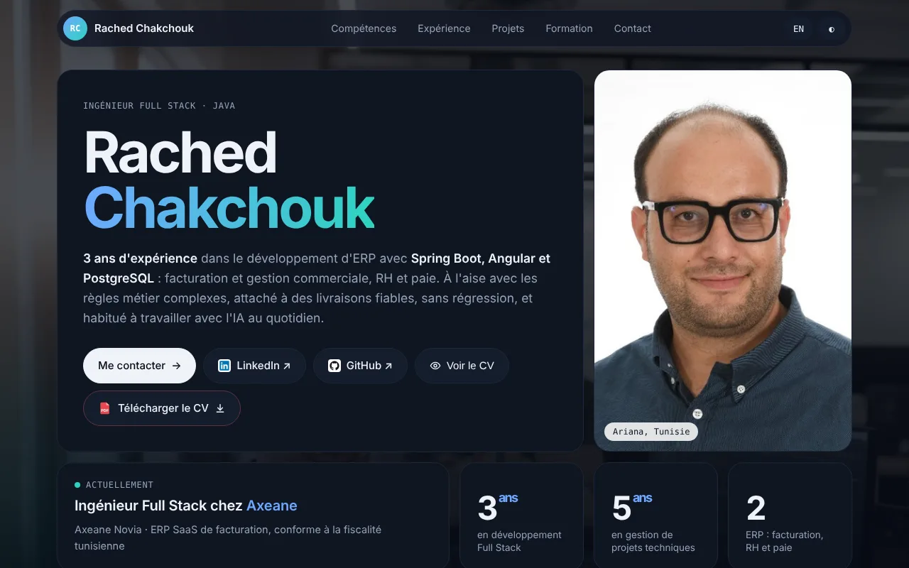
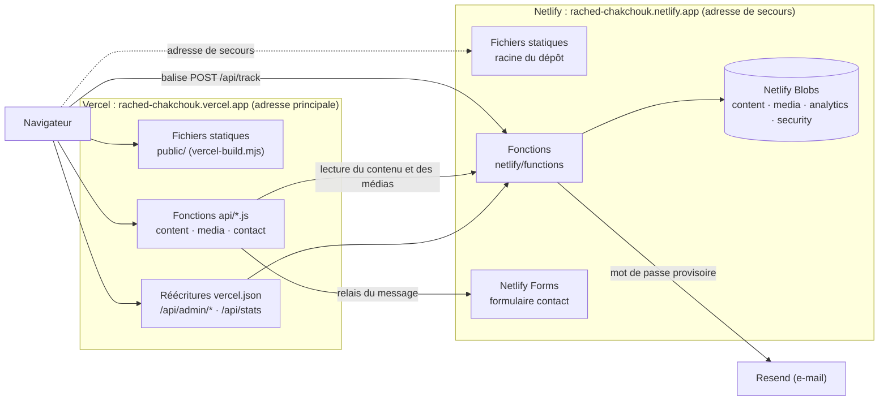

# Rached Chakchouk — Portfolio

**Français** · [English](README.en.md)

Site personnel bilingue (français / anglais) de Rached Chakchouk, ingénieur logiciel Full Stack Java / Spring Boot / Angular : une page d'accueil statique sans framework, des sous-pages publiques, un tableau de bord privé et un petit back-end serverless (Netlify Functions et Netlify Blobs).

- Adresse principale : https://rached-chakchouk.vercel.app (Vercel)
- Adresse de secours : https://rached-chakchouk.netlify.app (Netlify, non indexée), qui héberge aussi le back-end



## Aperçu

**Page d'accueil** (`index.html`, logique dans `assets/site.js`) :

- français ou anglais (bouton, `?lang=en`, `#en` / `#fr`), thème clair ou sombre (préférence du système par défaut) ; les deux choix sont mémorisés dans `localStorage` ;
- compétences, expériences, stages, projets, formation, langues et certifications, générés à partir du contenu (voir « Contenu du site et stockage ») ;
- projets : filtres par catégorie, tri (mise en avant, plus récents, nom), affichage en grille ou en liste, fiche détaillée en fenêtre modale et album des captures d'écran ;
- lecteur de CV en ligne (FR / EN) et téléchargement des PDF ;
- formulaire de contact avec validation dans le navigateur et champ piège anti-spam ;
- panneau d'accessibilité (`assets/a11y.js` : lecture vocale, loupe et taille du texte, modes pour daltoniens et contraste élevé), compteur d'empreinte carbone de la visite (`assets/carbon.js`, calcul local, aucune donnée envoyée), animations réduites si `prefers-reduced-motion` est actif ;
- mesure d'audience sans cookie (voir « Statistiques de visite »).

**Sous-pages publiques** :

| Chemin | Contenu |
|---|---|
| `/entretien/` | questions d'entretien technique (Java, Spring Boot, JPA, SQL, Angular, RxJS, REST, Git, Docker) expliquées avec des schémas animés, FR / EN, et leur version PDF |
| `/entretien/qcm/` | QCM de révision tiré au hasard (questions dans `mcq.json`), FR / EN |
| `/jobradar/` | présentation du projet JobRadar (veille d'offres d'emploi avec IA), FR / EN |
| `/offshore-it-tunisie/` | annuaire des sociétés IT offshore et nearshore en Tunisie (`data.json`, logos) |
| `/conditions/` | mentions légales et conditions d'utilisation, FR / EN |
| `/merci/` | confirmation après un envoi du formulaire sans JavaScript (non indexée) |

**Tableau de bord privé** (`/dashboard/`, « Portfolio Analytics », logique dans `assets/dashboard.js`) :

- connexion par mot de passe, changement du mot de passe, « Mot de passe oublié ? » (mot de passe provisoire envoyé par e-mail) ;
- **Statistiques** : visites et visiteurs par jour, pays, villes, sources, appareils, navigateurs, langues, actions des visiteurs, projets consultés et dernières visites, sur 7, 30 ou 90 jours ;
- **Contenu du site** : modification en français et en anglais du profil, des expériences, stages, projets, compétences, formation, langues et certifications (ajout, modification, réordonnancement, suppression), puis « Publier » ; retour possible au contenu d'origine ;
- **CV, photo et images** : remplacement ou réinitialisation des CV FR / EN (PDF, 4 Mo au plus) et de la photo, téléversement d'images pour les projets ou les logos (JPG, PNG ou WebP, 3 Mo au plus) ;
- mode démo signalé comme tel, avec des données fictives.

## Stack technique

| Couche | Technologie | Version |
|---|---|---|
| Pages | HTML, CSS et JavaScript sans framework ni étape de build | — |
| Polices | Geist, Geist Mono (Google Fonts) | — |
| Fonctions serverless | Netlify Functions (modules ES, bundler esbuild) et fonctions Vercel (`api/*.js`) | — |
| Stockage | Netlify Blobs (`@netlify/blobs`) | ^10.7.13 |
| Formulaire | Netlify Forms | — |
| E-mail | API Resend | — |
| Mesure d'audience | suivi maison (fonctions Netlify) et Vercel Web Analytics | — |

Aucune version de Node.js n'est fixée dans le dépôt (pas de champ `engines` ni de `.nvmrc`) ; les vérifications locales ont été faites avec Node.js 22. Icônes de technologies : Devicon et Simple Icons (voir `LICENSE`).

## Architecture

Le même dépôt alimente deux déploiements :

- **Vercel** (adresse principale) : `scripts/vercel-build.mjs` copie dans `public/` une liste explicite de fichiers publics (pages, contenu, CV, images, scripts `assets/`, tableau de bord), ajoute `assets/va.js` (Vercel Web Analytics) aux pages HTML publiques, sauf au tableau de bord, et génère `robots.txt` (indexation autorisée hors `/dashboard/`, `/api/` et `/merci/`) et `sitemap.xml` (pages publiques, variantes FR / EN). Le dossier `netlify/` n'est pas publié. Les fonctions `api/*.js` n'ont pas de stockage : elles lisent le back-end Netlify (`MAIN` dans `api/_main.js`) avec un délai maximal et se replient sur les fichiers statiques ; `/api/admin/*` et `/api/stats` sont réécrits vers Netlify (`vercel.json`).
- **Netlify** (adresse de secours et back-end) : `netlify.toml` publie la racine du dépôt telle quelle (`publish = "."`, sans commande de build) et déploie les fonctions de `netlify/functions`. Les données (Netlify Blobs), le formulaire de contact (Netlify Forms) et l'envoi d'e-mails sont de ce côté. `robots.txt` et l'en-tête `X-Robots-Tag: noindex` (`_headers`) excluent cette adresse des moteurs de recherche.



Comportement de la page d'accueil selon l'adresse (`assets/site.js`) :

| Adresse | Contenu | Photo et CV | Formulaire de contact | Suivi des visites |
|---|---|---|---|---|
| `rached-chakchouk.vercel.app` | `/api/content` (relais Vercel) | `/media/*` (relais Vercel) | `POST /api/contact` (relais vers Netlify Forms) | balise vers `https://rached-chakchouk.netlify.app/api/track`, plus Vercel Web Analytics |
| autre `*.vercel.app` (prévisualisations) | idem | idem | idem | aucun |
| `rached-chakchouk.netlify.app` | `/api/content` | `/media/*` | `POST /` (Netlify Forms) | `/api/track` |
| toute autre adresse (dont `localhost`) | contenu embarqué | fichiers du dépôt | désactivé : un message invite à copier l'adresse e-mail | aucun |

Le contenu embarqué reste affiché si rien n'a été publié ou si le back-end ne répond pas.

## Structure du dépôt

```text
.
├── index.html               # page d'accueil : balisage, styles, contenu par défaut (#defaultContent)
├── content.json             # contenu par défaut (même JSON que #defaultContent)
├── assets/
│   ├── site.js              # page d'accueil : contenu, langue, thème, projets, CV, contact, suivi
│   ├── dashboard.js         # tableau de bord
│   ├── a11y.js              # panneau d'accessibilité (toutes les pages)
│   ├── carbon.js            # compteur d'empreinte carbone
│   ├── float.js             # boutons flottants déplaçables et refermables
│   ├── totop.js             # bouton « Haut de page »
│   └── va.js                # Vercel Web Analytics (adresse principale uniquement)
├── dashboard/index.html     # page du tableau de bord privé
├── entretien/, jobradar/, offshore-it-tunisie/, conditions/, merci/   # sous-pages publiques
├── netlify/
│   ├── functions/           # une fonction Netlify par route (voir « API »)
│   └── lib/                 # analytics.mjs (suivi, médias, jetons, contenu), auth.mjs (mot de passe, e-mail)
├── api/                     # fonctions Vercel : _main.js, content.js, media.js, contact.js
├── scripts/vercel-build.mjs # build de l'adresse Vercel
├── vercel.json              # build, redirections, réécritures et en-têtes Vercel
├── netlify.toml, _headers, robots.txt   # configuration, en-têtes et robots de l'adresse Netlify
├── projects/, logos/, bg/   # captures des projets, logos, images d'arrière-plan
├── cv/                      # aperçus WebP des pages du CV (non référencés par le code actuel)
├── Rached_Chakchouk_CV_FR.pdf, Rached_Chakchouk_CV_EN.pdf, photo.jpg, og-image.jpg
├── .github/dependabot.yml   # mises à jour npm hebdomadaires (Dependabot)
├── .well-known/security.txt, SECURITY.md, LICENSE
└── package.json             # dépendance @netlify/blobs (pas de scripts npm)
```

## Prérequis

- Site seul : n'importe quel serveur de fichiers statiques (il n'y a pas d'étape de build).
- Fonctions et tableau de bord en local : Node.js et npm, plus la CLI Netlify (`netlify-cli`).

## Lancement en local

Les commandes sont identiques sous Windows (PowerShell) et sous Linux / macOS, sauf la définition des variables d'environnement.

### Site statique

```bash
git clone https://github.com/rachedchakchouk/rached-chakchouk-portfolio.git
cd rached-chakchouk-portfolio
npx serve@14.2.6 -l 8080
```

Ouvrez http://localhost:8080. Sur `localhost`, la page n'appelle aucune API : elle affiche le contenu embarqué, la photo et les CV du dépôt ; le suivi des visites et l'envoi du formulaire sont désactivés. Le tableau de bord (http://localhost:8080/dashboard/) n'offre alors que le mode démo (« Voir une démo »).

### Avec les fonctions Netlify (tableau de bord, API)

Le dépôt n'a pas de `package-lock.json` : installez la dépendance avec `npm install`, puis la CLI Netlify.

```bash
npm install
npm install -g netlify-cli
```

PowerShell :

```powershell
$env:DASHBOARD_PASSWORD = "<mot de passe local>"
netlify dev --offline
```

Linux / macOS :

```bash
DASHBOARD_PASSWORD='<mot de passe local>' netlify dev --offline
```

Le site et les fonctions sont servis sur http://localhost:8888 (tableau de bord : http://localhost:8888/dashboard/). Avec `--offline`, aucun compte Netlify n'est utilisé : les Netlify Blobs sont simulés dans le dossier `.netlify/`, que la CLI exclut de Git en créant un `.gitignore`. Définissez les variables dans la session comme ci-dessus plutôt que dans un fichier `.env`, que rien n'exclut de Git dans ce dépôt.

Sur `localhost`, la page d'accueil n'appelle toujours ni `/api/content` ni `/media/*` : le contenu publié depuis le tableau de bord local est servi par http://localhost:8888/api/content mais n'est pas affiché par la page. « Mot de passe oublié » demande en plus `RESEND_API_KEY` (sinon réponse 503 `mail_not_configured`).

### Build Vercel

```bash
node scripts/vercel-build.mjs
```

Le script génère `public/`, que rien n'exclut de Git : ne le commitez pas. Les fonctions `api/*.js` appellent toujours le back-end de production (`MAIN` dans `api/_main.js`) : les exécuter en local, par exemple avec la CLI Vercel, lirait les vraies données et `/api/contact` enverrait un vrai message.

## Configuration

Variables d'environnement des fonctions Netlify (Netlify → Project configuration → Environment variables), lues avec `Netlify.env.get`. Aucune valeur n'est stockée dans le dépôt.

| Variable | Rôle | Obligatoire |
|---|---|---|
| `DASHBOARD_PASSWORD` | mot de passe initial du tableau de bord et secret de signature des jetons de session ; reste nécessaire après un changement de mot de passe. Sans elle, les routes d'administration et `/api/stats` répondent 503 `not_configured` | oui |
| `ANALYTICS_SALT` | sel du hachage des visiteurs (visiteurs uniques, limitations de débit) ; sans elle, une valeur par défaut écrite dans le code est utilisée | recommandée |
| `RESEND_API_KEY` | clé de l'API Resend pour l'e-mail « Mot de passe oublié » ; sans elle, `/api/admin/forgot` répond 503 `mail_not_configured` | pour « Mot de passe oublié » |
| `ADMIN_EMAIL` | destinataire de cet e-mail (valeur par défaut dans `netlify/lib/auth.mjs`) | non |
| `MAIL_FROM` | expéditeur de cet e-mail (valeur par défaut dans `netlify/lib/auth.mjs`) | non |

Le déploiement Vercel ne lit aucune variable d'environnement. Les adresses des deux sites sont écrites dans le code, notamment `MAIN` (`api/_main.js`), `MAIN_HOST` et `BACKUP_HOST` (`assets/site.js`), `MAIN_HOST` (`netlify/functions/track.mjs`), `TRUSTED_HOSTS` (`netlify/lib/auth.mjs`), `assets/va.js`, `scripts/vercel-build.mjs` ainsi que les réécritures et la CSP de `vercel.json`.

## Contenu du site et stockage

- **Contenu par défaut** : `index.html` embarque le JSON du contenu dans `<script type="application/json" id="defaultContent">`, que la page lit au chargement ; `content.json` contient le même JSON et sert de contenu d'origine au tableau de bord. Les deux doivent rester identiques. Format : `version: 1`, `profile`, `skills`, `experiences`, `internships`, `projects`, `education`, `languages`, `certifications`, avec des textes bilingues `{ "fr": …, "en": … }`.
- **Contenu publié et fichiers téléversés** : Netlify Blobs. Il n'y a ni base de données ni migration.

| Magasin | Clés | Contenu |
|---|---|---|
| `content` | `site` | contenu publié (JSON nettoyé, date de mise à jour en métadonnée) |
| `media` | `cv-fr.pdf`, `cv-en.pdf`, `photo`, `img-<nom>` | fichiers téléversés, avec type, taille, date et nom d'origine |
| `analytics` | `e/<AAAA-MM-JJ>/<horodatage>-<aléa>` | un enregistrement par page vue ou action |
| `security` | `auth/state`, `login-fail/…`, `forgot/…`, `rl/…`, `cap/…` | état du mot de passe (hachage scrypt, génération, mot de passe provisoire) et compteurs de limitation |

## API

Fonctions Netlify (`netlify/functions/*.mjs`, route déclarée par `export const config = { path }`). « Jeton » désigne l'en-tête `Authorization: Bearer <jeton>` obtenu à la connexion ; une « session normale » exclut la session ouverte avec le mot de passe provisoire, qui ne sert qu'à choisir un nouveau mot de passe.

| Méthode | Route | Accès | Rôle |
|---|---|---|---|
| GET | `/api/content` | public | contenu publié ; 404 si rien n'est publié |
| GET | `/media/:name` | public | fichier téléversé ; sinon redirection 302 vers le fichier d'origine (`cv-fr.pdf`, `cv-en.pdf`, `photo`) ou 404 (`img-*`) |
| POST | `/api/track` | public (même origine ou adresse principale) | enregistre une page vue ou une action (`cv_download`, `cv_view`, `linkedin`, `github`, `project_open`, `contact_submit`, `email_copy`, `phone_copy`) |
| POST | `/api/admin/login` | mot de passe | renvoie `{ token, exp, mustChange }` |
| POST | `/api/admin/forgot` | public, limité | envoie un mot de passe provisoire à l'adresse d'administration |
| POST | `/api/admin/password` | jeton | change le mot de passe (`current` exigé sauf en session provisoire, `next`) et renvoie un nouveau jeton |
| GET, PUT, DELETE | `/api/admin/content` | jeton, session normale | lit, publie (JSON de 400 Ko au plus, nettoyé puis validé) ou supprime le contenu publié |
| GET, PUT, DELETE | `/api/admin/media?name=` | jeton, session normale | liste, téléverse (corps brut, type vérifié par signature) ou supprime un fichier |
| GET | `/api/stats?days=` | jeton, session normale | statistiques agrégées sur 1 à 90 jours (30 par défaut) |

Fonctions et règles Vercel (`api/*.js`, `vercel.json`) :

| Méthode | Route | Rôle |
|---|---|---|
| GET | `/api/content` | relaie `/api/content` de Netlify (délai de 4 s) ; 204 si Netlify ne répond pas ou renvoie une erreur |
| GET | `/media/:name` | réécrit vers `/api/media?name=` : relaie le fichier de Netlify (délai de 6 s), sinon redirige vers le fichier statique |
| POST | `/api/contact` | contrôle le message (même origine, 6 000 caractères au plus, champ piège, nom, e-mail, message d'au moins 10 caractères) et le transmet au formulaire Netlify `contact` (délai de 8 s) |
| toutes | `/api/admin/*`, `/api/stats` | réécrits vers les mêmes routes de Netlify |

Redirections temporaires vers `/dashboard/` : `/dashboard`, `/admin`, `/admin/`, `/dashborad`, `/dashborad/`.

## Statistiques de visite

- **Envoi** (`assets/site.js`) : `navigator.sendBeacon` en `text/plain` (pas de requête préalable CORS depuis Vercel) à chaque page vue et sur les actions suivies, uniquement sur les deux adresses de production. Rien n'est envoyé si *Do Not Track* est actif ou si `rc_ignore` vaut `1` dans `localStorage` ; cette marque est posée quand le tableau de bord s'affiche, ou en visitant le site une fois avec `?notrack`.
- **Réception** (`netlify/functions/track.mjs`) : robots filtrés par user-agent ; 40 évènements au plus par visiteur et par 10 minutes, 5 000 par jour ; pays et ville issus de la géolocalisation de Netlify. L'adresse IP n'est jamais stockée : un hachage SHA-256 tronqué de (sel, jour, IP, user-agent) identifie le visiteur pour la journée.
- **Conservation** : chaque appel de `/api/stats` supprime les enregistrements de plus de 13 mois.
- **Vercel Web Analytics** (`assets/va.js`) : chargé seulement sur `rached-chakchouk.vercel.app`, avec les mêmes exclusions (*Do Not Track*, `rc_ignore`).

## Tests

Le dépôt ne contient ni test automatisé ni script npm. `netlify/lib/analytics.mjs` regroupe la logique sans dépendance (agrégation, analyse du user-agent, sources, contrôle des fichiers, jetons, nettoyage du contenu), qui peut être testée isolément.

## Build, CI et déploiement

- Aucun workflow GitHub Actions. Dependabot (`.github/dependabot.yml`) propose les mises à jour npm (`@netlify/blobs`) chaque lundi à 06:00 (Africa/Tunis) : 5 PR ouvertes au plus, préfixe de commit `deps`, label `dépendances`, groupes `securite` (correctifs de sécurité) et `mineures-et-correctifs`.
- **Vercel** : `vercel.json` (`framework: null`, `buildCommand: node scripts/vercel-build.mjs`, `outputDirectory: public`). Le projet Vercel est relié au dépôt : les commits de `main` sont déployés en production et les branches de PR en prévisualisation (statuts « Vercel » sur les commits).
- **Netlify** : `netlify.toml` (`publish = "."`, fonctions dans `netlify/functions`, bundler esbuild), sans commande de build ; le formulaire `contact` est déclaré à Netlify Forms par l'attribut `data-netlify="true"` (champ piège `_gotcha`). Le site Netlify est relié au dépôt (les PR reçoivent des « Deploy Previews ») ; la publication des déploiements de production se règle dans l'interface Netlify, hors du dépôt. Les routes d'administration et de statistiques de l'adresse Vercel passant par Netlify, vérifiez après toute modification de `netlify/` que le déploiement de production Netlify correspondant est bien publié.

## Sécurité

- **En-têtes** (`_headers` pour Netlify, `vercel.json` pour Vercel) : HSTS (1 an, `preload`), CSP (`script-src 'self'` sans script inline ; styles inline et Google Fonts autorisés ; sur Vercel, `connect-src` inclut l'adresse Netlify pour la balise de suivi), `frame-ancestors 'self'` et `X-Frame-Options: SAMEORIGIN`, `X-Content-Type-Options: nosniff`, `Referrer-Policy: strict-origin-when-cross-origin`, `Permissions-Policy` restrictive, COOP et CORP `same-origin`, `Origin-Agent-Cluster`. Sur les deux hébergeurs, `/dashboard/` reçoit `noindex, nofollow` et `Cache-Control: no-store`.
- **Connexion** : le mot de passe n'est envoyé qu'à `/api/admin/login` ; il est comparé en temps constant à `DASHBOARD_PASSWORD`, ou à un hachage scrypt salé une fois changé depuis le tableau de bord. Le jeton de session (HMAC-SHA256, 2 h) est gardé dans `sessionStorage`. 5 échecs d'un même visiteur verrouillent la connexion 15 minutes.
- **Mot de passe** : 10 caractères au moins et 3 types de caractères ; chaque changement invalide toutes les autres sessions. Le mot de passe provisoire est valable 15 minutes, à usage unique, et envoyé à l'adresse fixe d'administration (jamais prise dans la requête) ; 3 demandes par visiteur et par heure, 6 par jour.
- **Origine** : connexion, mot de passe oublié et changement de mot de passe n'acceptent que la même origine ou `rached-chakchouk.vercel.app` ; `/api/track` accepte la même origine ou l'adresse principale.
- **Contenu et fichiers** : contenu nettoyé côté serveur (clés, longueurs, profondeur, URL non sûres retirées) et toujours échappé à l'affichage ; fichiers limités en taille, type réel vérifié par signature, servis avec `nosniff` (et une CSP `sandbox` pour les images).
- Signalement d'une vulnérabilité : [SECURITY.md](SECURITY.md) et `/.well-known/security.txt`.

## Licence

© 2026 Rached Chakchouk — tous droits réservés. Le code est publié pour consultation uniquement ; photos, CV et contenus personnels ne peuvent pas être réutilisés sans autorisation. Voir [LICENSE](LICENSE), qui indique aussi les licences des ressources tierces (Devicon, Simple Icons, polices Geist).

## Auteur

**Rached Chakchouk** — ingénieur logiciel Full Stack (Java / Spring Boot / Angular)

- LinkedIn : [linkedin.com/in/rached-chakchouk](https://linkedin.com/in/rached-chakchouk)
- GitHub : [github.com/rachedchakchouk](https://github.com/rachedchakchouk)
